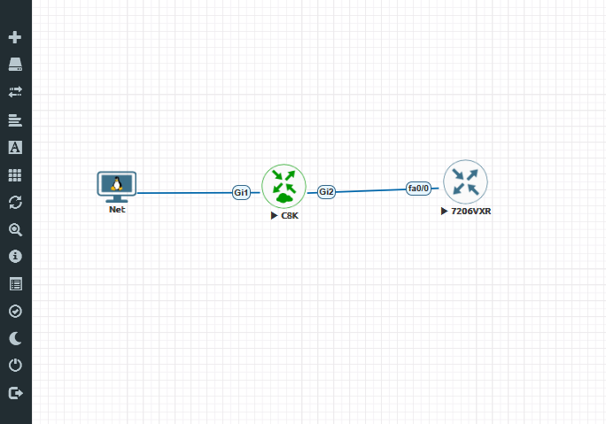
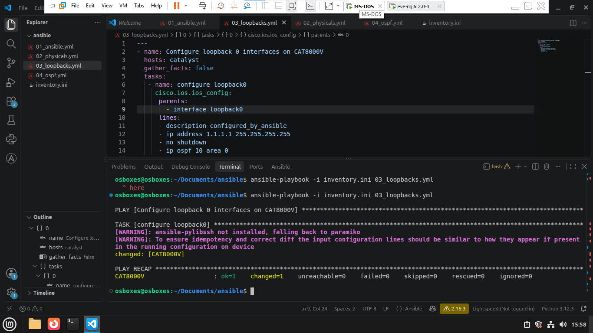
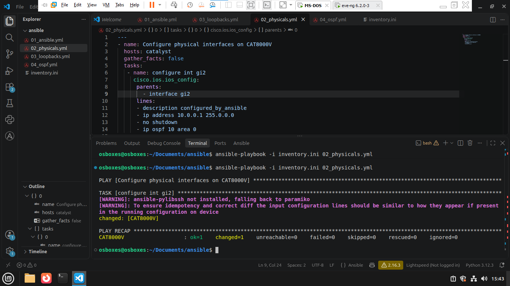
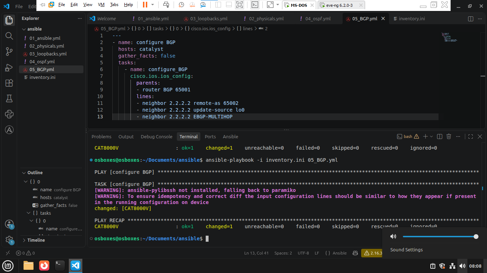
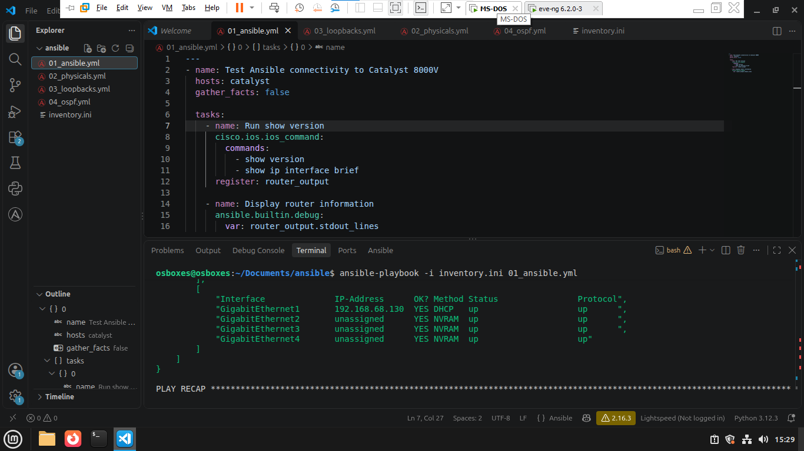
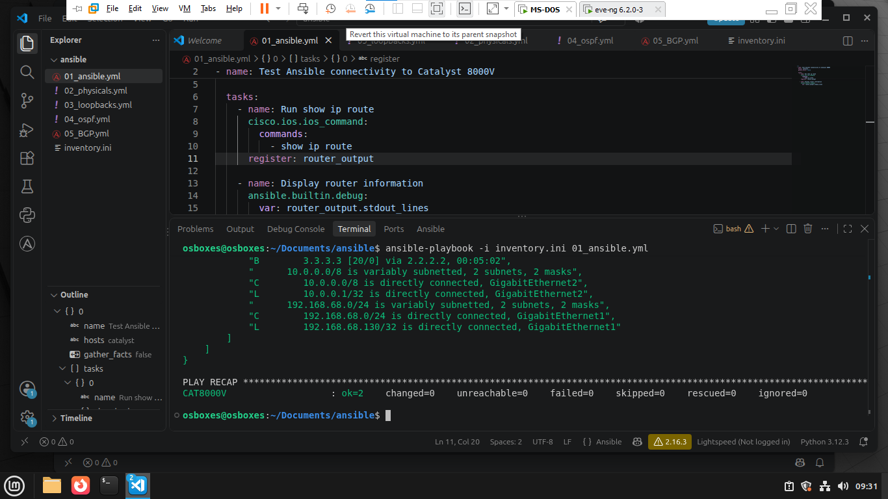
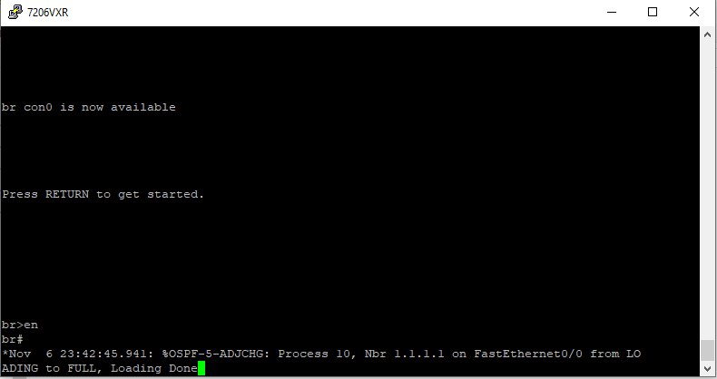
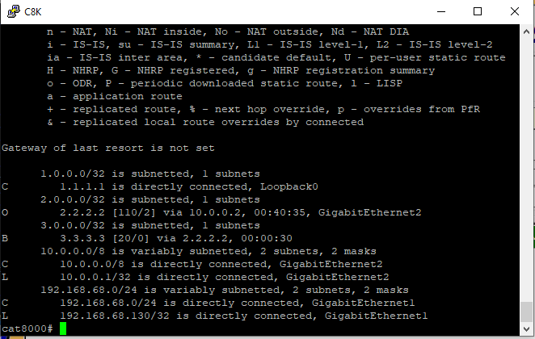

# Network Automation Lab: Configuring a Cisco C8000V with Ansible

A lab in EVE-NG where Ansible configures a Cisco Catalyst 8000V (C8Kv) router: an interface, a loopback, OSPF and an eBGP neighbor. A Cisco 7206VXR on the other side was configured by hand from the CLI, and the two routers form the OSPF and BGP relationships.

> This is a lab environment built for learning network automation.



## Setup

| Device | Role | How it was configured |
|---|---|---|
| Linux Mint VM | Ansible control node, outside EVE-NG, connected through a bridged NIC | n/a |
| Cisco C8000V (C8Kv) | Router | **Ansible** |
| Cisco 7206VXR | Router, the peer | **CLI** (manual) |

## Why only the C8Kv is automated

Both routers could not be automated in this lab:

- The C8Kv needs a lot of memory, so the host's resources were limited.
- The 7206VXR only supports legacy SSH encryption, which makes it hard to manage with Ansible.

So the C8Kv is the device configured by Ansible, and the 7206VXR was configured from the CLI.

## What is configured

| Device | Method | Configuration |
|---|---|---|
| C8Kv | Ansible | Physical interface, Loopback0, OSPF, BGP neighborship |
| 7206VXR | CLI | Physical interface, Loopback0, OSPF, BGP neighborship, BGP network advertisement |

### C8Kv design

| Item | Value |
|---|---|
| Interface | GigabitEthernet2, 10.0.0.1/8, OSPF process 10, area 0 |
| Loopback0 | 1.1.1.1/32, OSPF process 10, area 0 |
| OSPF | Process 10, router-id 1.1.1.1 |
| BGP | AS 65001, neighbor 2.2.2.2 (AS 65002) |
| BGP session | Sourced from Loopback0, with eBGP multihop |

The two routers learn each other's loopbacks through OSPF. The eBGP session is then built between the loopback addresses, which is why the session uses `update-source` and `ebgp-multihop`.

## Playbooks

The playbooks run against the host group `catalyst` and use the `cisco.ios` collection. They are meant to run in order.

| Playbook | What it does | Module |
|---|---|---|
| `01_ansible.yml` | Connectivity test: runs `show ip route` and prints the output | `cisco.ios.ios_command` |
| `02_physicals.yml` | Configures the physical interface (description, IP address, no shutdown, OSPF) | `cisco.ios.ios_config` |
| `03_loopbacks.yml` | Configures Loopback0 and enables OSPF on it | `cisco.ios.ios_config` |
| `04_ospf.yml` | Configures the OSPF process and router-id | `cisco.ios.ios_config` |
| `05_BGP.yml` | Configures the BGP process and the eBGP neighbor | `cisco.ios.ios_config` |
| `06_Save.yml` | Saves the running configuration | `cisco.ios.ios_config` |

Screenshots of the playbooks and their results:








## How to run

1. Install Ansible and the Cisco IOS collection on the control node:

   ```
   ansible-galaxy collection install cisco.ios
   ```

2. Copy the example inventory and fill in your own router address and credentials. `inventory.ini` is listed in `.gitignore`, so the real credentials are never committed:

   ```
   cp inventory.ini.example inventory.ini
   ```

   The inventory has one group, `catalyst`, with the C8Kv. It connects with `ansible.netcommon.network_cli` and uses the `cisco.ios.ios` network OS with enable mode.
3. Run the playbooks in order:

   ```
   ansible-playbook -i inventory.ini 01_ansible.yml
   ansible-playbook -i inventory.ini 02_physicals.yml
   ansible-playbook -i inventory.ini 03_loopbacks.yml
   ansible-playbook -i inventory.ini 04_ospf.yml
   ansible-playbook -i inventory.ini 05_BGP.yml
   ansible-playbook -i inventory.ini 06_Save.yml
   ```

## Verification

Interface state and the routing table on the C8Kv, collected with Ansible:





The 7206VXR sees the C8Kv as an OSPF neighbor:



BGP is up and routes are learned:



## Repository structure

```
.
├── 01_ansible.yml
├── 02_physicals.yml
├── 03_loopbacks.yml
├── 04_ospf.yml
├── 05_BGP.yml
├── 06_Save.yml
├── inventory.ini.example
├── .gitignore
├── README.md
└── images/
```

## What I learned

- Configuring a Cisco IOS XE router with Ansible instead of typing commands
- Building OSPF and eBGP between two routers on different platforms, with BGP peering between loopbacks
- Verifying the result with show commands collected by Ansible
- Dealing with real lab limits: memory on the host and legacy SSH on older devices

## Author

Ezzaldien Osman, Junior Network Engineer
LinkedIn: [linkedin.com/in/ezzaldeen-osman-mohamed](https://linkedin.com/in/ezzaldeen-osman-mohamed)
